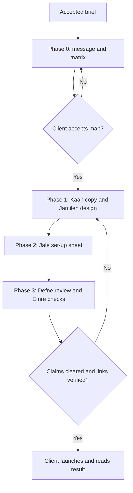

# Workflow: Agency Ad Creative Sprint

## Overview & Purpose
Chris coordinates Ava, Kaan, Jamileh, Jale, Defne and Emre for one message, three to six deliberate variants, reviewed claims and tagged links. The cycle starts with client acceptance and ends with a measured result.

## Execution Triggers
Load it for "new ads for the launch" or "test three angles". Do not load it for brand identity (`workflow-agency-brand-design-system`) or a full engagement (`workflow-agency-full-campaign`). Nothing here buys media or publishes an ad: the client or the lead does that with their own account.

## Input/Output Requirements
Inputs: the accepted brief, the audience, the offer and its proof, the placements the client has budget for, brand tokens, required legal copy, what earlier ads taught.

Output: the creative brief with the single message; the variant matrix; copy per variant (Kaan); design specs per ratio (Jamileh, with `ad-creative-design`); the set-up sheet with names and UTM tags (Jale); Defne's claims and disclosure review; Emre's link and landing-page check. **Evidence to attach**: the source of each claim and the path of each asset file.

## Step-by-Step Runbook

1. **Phase 0: message and map.** Ava states audience, single message and metric (cost per qualified signup, not clicks); Chris presents the Delegation map. Variants change angle (outcome, proof, objection) or format, never both.
2. **Phase 1: copy and design.** Kaan writes one sourced claim per variant; Jamileh designs per placement (platform sizes verified), keeping Kaan's headline fixed.
3. **Phase 2: set-up sheet.** Jale records ad names equal to `utm_content`, tagged links, client audiences and exclusions. Jale creates no accounts or campaigns.
4. **Phase 3: review.** Defne reviews claims, comparisons, "free", prices, endorsements and sponsored disclosure; Emre verifies destinations, tracking and the landing page's agreement with the ad promise.
5. **Hand to the client** to set up and launch; Ava defines the stop rule and the day the result is read.

| Transition | Prerequisites | Gate (evidence) | Success criteria |
|---|---|---|---|
| Phase 0 -> Phase 1 | Single message and matrix agreed | The client accepted the delegation map | One message, one change between variants |
| Phase 1 -> Phase 2 | Copy and design exist as files | Lead has read both back with paths | Every claim has a source in the list |
| Phase 2 -> Phase 3 | Set-up sheet drafted | Names and UTM scheme listed | Each ad name equals its utm_content |
| Phase 3 -> Hand-off | Defne cleared and Emre green | Both reports read in full | No unsupported claim; links verified |

Rollback protocol: if Defne rejects a claim, the variant is withdrawn or rewritten (Kaan, then Jamileh), the sheet is renamed v2 and Phase 3 re-runs on the changed assets only; if the landing page does not match the promise, Kaan revises the page copy, not the ad.

**Optional media.** Chris records Media Requests and include/defer/decline during bounded consultation. If installed and included, load `workflow-agency-motion-production` under this Lead: approved brand/copy/assets, timing approval, production, Sound handoff, applicable render and review. Sound-only needs no Motion/video; static/defer/decline starts no production, install or provider.

## Code & Config Exemplars
Load [examples/worked-example.md](examples/worked-example.md) for a three-angle sprint: the variants, names, stop rule and read-out. The playbook above works without it.

Anti-patterns, each with its reason:
- Three messages in one ad set: no result explains itself.
- Variants that differ in five ways: the same.
- Ads set up before the claims review: a rejected claim is found after spend.
- Results read before the stated impressions: it is noise.
- A specialist creating an ad account or spending: out of role.
- A landing page that does not carry the ad's promise: the click is wasted.

## Edge Cases & Error Recovery
- **A platform rejects an ad**: record the reason, fix that point, rename the variant and re-run Defne's review on it.
- **No proof for the strongest claim**: drop that variant; never fabricate or soften wording to hide it.
- **The client wants a competitor named**: Defne first; Kaan drafts only after clearance.
- **Brand tokens missing**: Jamileh uses a labelled provisional palette only if the client agrees.
- **Results disagree with the stop rule**: report both and let the client decide; do not move the goalposts.

## Verification Checklist
- [ ] One message; variants differ by one dimension; names match `utm_content`.
- [ ] Every claim has a source; Defne has cleared them in writing.
- [ ] Every link carries the four UTM fields and Emre verified the landing and tracking.
- [ ] Ava wrote the stop rule and the read-out days.
- [ ] This team published and bought nothing; the hand-off to the client is explicit.
- [ ] A rollback route is written for a rejected claim and a rejected ad.
