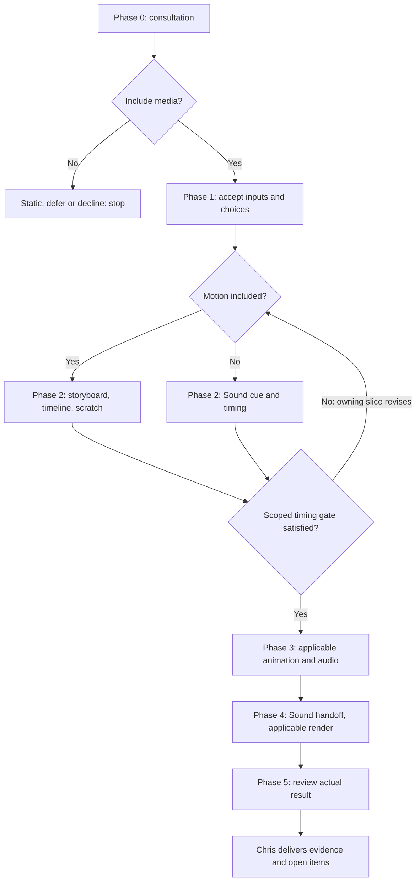

## Overview & Purpose
Chris coordinates; Motion owns visual timing/animation/integration; Sound owns sonic direction/sources/audio. Kaan owns exact words; Jamileh owns visuals. Preference fields alone authorize no production, install or paid job; reuse the user's actual accepted scope and setup instructions.

## Execution Triggers
Load for an included film/loop/soundtrack or Media Request in bounded planning. Static/defer/decline stops without production, install or provider setup. Outside digital-agency, its discipline's Lead retains coordination.

## Input/Output Requirements
Require accepted brief/map/request, approved brand/assets/exact copy, rights, destination/accessibility, owners and cost/setup scope. Return choices, applicable storyboard/timeline, Sound handoff, export, captions/transcript, provenance and evidence. Helper needs Node >=24 and installed sibling `audiovisual-review/scripts/review.mjs`.

## Treatment and approval

Chris proactively recommends a coherent treatment covering voiceover, SFX, music, captions and Elements (for Remotion); the user need not request each. For each applicable option present include / defer / decline, recommendation, reason, dependencies and known effort or external cost. Silence, no VO and no Elements are valid. Native uses no automatic Elements or Remotion setup. Preserve already accepted choices and ask only unresolved questions. Ask intended use (personal private, noncommercial public or commercial); it is not proof of rights. Within at most two planning rounds, seek one consolidated actual user acceptance of the treatment plan and delegation map; carry forward existing explicit acceptance rather than ask twice. Then obtain explicit scoped timing approval for the relevant timeline or beat map before dependent production. A material change reopens only affected choices or timing.

Every cross-role handoff records gate, status, approver, source/reference, revision and open items. A route or tone choice is not acceptance of the audio map or evidence of listening, perceived sync or creative acceptance. Distinguish actual user evidence from lead decisions, specialist reports, numerical passes and unknowns. If the user explicitly delegates approval authority, record its scope and the delegate decision; if the user waives a gate, record a scoped waiver as such, not human review. Neither delegation nor waiver invents listening or a numerical pass. Do not request permission again for an already authorized choice. See [treatment plan](assets/treatment-plan.example.md), [approval handoff](assets/approval-handoff.example.md), and, when rights review is needed for Native or Remotion, load the installed `remotion-production` Skill and resolve its root for `references/asset-rights.md` and `assets/used-assets.example.md`.

## Step-by-Step Runbook

1. **Phase 0: consult.** Relevant specialists specify placement/audience/purpose, asset/copy/brand refs, duration/ratio/format, accessibility, dependencies, route, cost and acceptance. Chris consolidates questions/include/defer/decline within planning/peer limits; do not spawn all specialists.
2. **Phase 1: accept and save.** Recommend Native HTML/SVG/canvas or offer independent Remotion React; choose local/API/hybrid audio and footage separately. Reuse supplied/licensed assets. Save/read back the complete [project contract](references/project-contract.md). Defaults: 1920x1080/60fps H264/AAC; stereo48k, -16 LUFS +/-1, <=-1 dBTP. Retain overrides; provider/model/USD preferences are not consent.
3. **Phase 2: approve timing.** Motion storyboards/animatics and creates the canonical frame timeline; Sound supplies scratch as needed. Sound-only WAV/sonic-logo uses Sound-owned, lead-approved cue/timing; skip Motion/storyboard/renderer install/video. Schema-required video fields stay unused defaults. Chris records explicit scoped user timing approval or the user's scoped delegation/waiver before dependent final production; lead decisions remain distinct from user evidence.
4. **Phase 3: produce.** Motion animates and Sound generates/edits/mixes in parallel when applicable, using invoked direction and renderer/audio Skills. For Remotion, one setup owner loads `remotion-production` and its `references/setup-and-elements.md` from the resolved installed Skill root; Chris checks readiness and directs component selection before delegating production. Reuse existing local setup authorization, preserve locked projects, and distinguish installed/discovered/invoked/used. Nontrivial revisions return to their specialist owners. Optional video-generation/mcp-setup need opt-in, installed resources and actual account/tool/per-job authorization.
5. **Phase 4: hand off.** Sound returns stereo48k WAV, aligned pre-master stems, cues, revision/fingerprint, manifest, applicable transcript/captions, provenance and measurement/listening evidence. Motion validates/integrates/renders if included; Sound-only goes through review directly to Chris. Never invent speech.
6. **Phase 5: review and deliver.** Creative/Copy, QA and Compliance use audiovisual-review on the actual export: decode, measurements, viewing/listening/sync, accessibility, claims and rights. Chris reads evidence/open items; preserve normal launch, hand-back and shutdown protocol.

| Transition | Gate evidence and success criteria |
|---|---|
| Phase 0 -> 1 | Included request and accepted map; owners, rights, exact copy/assets available |
| Phase 2 -> 3 | Explicit scoped timing approval or recorded delegation/waiver for current timing/copy and computed fingerprint before dependent production |
| Phase 3 -> 4 | Final Sound handoff matches current revision/fingerprint; integration waits |
| Phase 4 -> 5 -> acceptance | Required reviews must pass; report unresolved checks as unverified |

Rollback protocol: timing/speech/fps/canvas drift invalidates dependent fingerprints/handoffs even at the same revision. Stop dependents; return changes through Chris to their owner for reapproval/reissue before integration. Review defects return to affected owners, then recheck; preserve sources/revisions. Details: [production gates](references/production-gates.md).

## Code & Config Exemplars
`node "${CLAUDE_SKILL_DIR}/scripts/project.mjs" init --project <absolute-project> --preferences <absolute-approved-json>` validates/exclusively creates `media/project.json`; `status --project <absolute-project>` validates read-back. Other Hosts resolve this Skill's absolute root. Load [the worked example](examples/worked-example.md) for detail; this playbook is self-contained. Adapt [request](assets/media-request.example.json) and [full preferences](assets/project.example.json), never partial JSON. Review validates request/timeline/audio structurally; it does not review actual media.

## Edge Cases & Error Recovery
Preserve existing preferences (`project.exists`): inspect status/review edits; no force/overwrite. Missing assets, unsafe links, unavailable runtime/provider or stale audio blocks dependents; retain plan and ask Chris. Anti-patterns: both renderers to delay choice, ceiling as consent, silent cloud fallback, shortened approved copy.

## Verification Checklist
- Scope/owners/inputs/timing approval precede production; saved choices match output.
- Provider and each paid job have evidence; Sound matches revision/fingerprint/source identities.
- Separate structural checks, measurements, viewing/listening and provenance; missing checks say **unverified**.
- Chris receives source/export/evidence paths, open decisions, bounded recheck scope and lifecycle evidence.

## Picture event handoff

For picture-dependent final SFX, Motion verifies action frames from actual animation math or viewed movement and loads the installed `audiovisual-review` Skill, resolves its root and follows `references/motion-events.md` to capture the versioned picture event sidecar; Sound validates the actual artifact against the current timeline and listed picture sources before final dependent SFX. Independent sound design can proceed in parallel. Timeline or picture-source changes require a rechecked, recaptured sidecar and affected Sound handoff. The helper does not prove frame accuracy, approval, viewing or listening. Sound-only work does not require Motion events.
