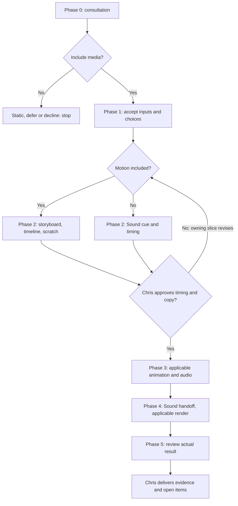

## Overview & Purpose
Chris coordinates; Motion owns visual timing/animation/integration; Sound owns sonic direction/sources/audio. Kaan owns exact words; Jamileh owns visuals. Saved choices authorize no production, install or paid job.

## Execution Triggers
Load for an included film/loop/soundtrack or Media Request in bounded planning. Static/defer/decline stops without production, install or provider setup. Outside digital-agency, its discipline's Lead retains coordination.

## Input/Output Requirements
Require accepted brief/map/request, approved brand/assets/exact copy, rights, destination/accessibility, owners and cost/setup scope. Return choices, applicable storyboard/timeline, Sound handoff, export, captions/transcript, provenance and evidence. Helper needs Node >=24 and installed sibling `audiovisual-review/scripts/review.mjs`.

## Step-by-Step Runbook

1. **Phase 0: consult.** Relevant specialists specify placement/audience/purpose, asset/copy/brand refs, duration/ratio/format, accessibility, dependencies, route, cost and acceptance. Chris consolidates questions/include/defer/decline within planning/peer limits; do not spawn all specialists.
2. **Phase 1: accept and save.** Recommend Native HTML/SVG/canvas or offer independent Remotion React; choose local/API/hybrid audio and footage separately. Reuse supplied/licensed assets. Save/read back the complete [project contract](references/project-contract.md). Defaults: 1920x1080/60fps H264/AAC; stereo48k, -16 LUFS +/-1, <=-1 dBTP. Retain overrides; provider/model/USD preferences are not consent.
3. **Phase 2: approve timing.** Motion storyboards/animatics and creates the canonical frame timeline; Sound supplies scratch as needed. Sound-only WAV/sonic-logo uses Sound-owned, lead-approved cue/timing; skip Motion/storyboard/renderer install/video. Schema-required video fields stay unused defaults. Chris approves timing/exact copy before final production.
4. **Phase 3: produce.** Motion animates and Sound generates/edits/mixes in parallel when applicable, using installed direction and renderer/audio Skills. Optional video-generation/mcp-setup need opt-in, installed resources and actual account/tool/per-job authorization.
5. **Phase 4: hand off.** Sound returns stereo48k WAV, aligned pre-master stems, cues, revision/fingerprint, manifest, applicable transcript/captions, provenance and measurement/listening evidence. Motion validates/integrates/renders if included; Sound-only goes through review directly to Chris. Never invent speech.
6. **Phase 5: review and deliver.** Creative/Copy, QA and Compliance use audiovisual-review on the actual export: decode, measurements, viewing/listening/sync, accessibility, claims and rights. Chris reads evidence/open items; preserve normal launch, hand-back and shutdown protocol.

| Transition | Gate evidence and success criteria |
|---|---|
| Phase 0 -> 1 | Included request and accepted map; owners, rights, exact copy/assets available |
| Phase 2 -> 3 | Chris approves current timing/copy and computed fingerprint before production |
| Phase 3 -> 4 | Final Sound handoff matches current revision/fingerprint; integration waits |
| Phase 4 -> 5 -> acceptance | Required reviews must pass; report unresolved checks as unverified |

Rollback protocol: timing/speech/fps/canvas drift invalidates dependent fingerprints/handoffs even at the same revision. Stop dependents; return changes through Chris to their owner for reapproval/reissue before integration. Review defects return to affected owners, then recheck; preserve sources/revisions. Details: [production gates](references/production-gates.md).

## Code & Config Exemplars
`node "${CLAUDE_SKILL_DIR}/scripts/project.mjs" init --project <absolute-project> --preferences <absolute-approved-json>` validates/exclusively creates `media/project.json`; `status --project <absolute-project>` validates read-back. Other Hosts resolve this Skill's absolute root. Load [the worked example](examples/worked-example.md) for detail; this playbook is self-contained. Adapt [request](assets/media-request.example.json) and [full preferences](assets/project.example.json), never partial JSON. Review validates request/timeline/audio structurally; it does not review actual media.

## Edge Cases & Error Recovery
Preserve existing preferences (`project.exists`): inspect status/review edits; no force/overwrite. Missing assets, unsafe links, unavailable runtime/provider or stale audio blocks dependents; retain plan and ask Chris. Anti-patterns: both renderers to delay choice, ceiling as consent, silent cloud fallback, shortened approved copy.

## Verification Checklist
- Scope/owners/inputs/timing approval precede production; saved choices match output.
- Provider and each paid job have evidence; Sound matches revision/fingerprint/source identities.
- Separate structural checks, measurements, viewing/listening and provenance; missing checks say **unverified**.
- Chris receives source/export/evidence paths, open decisions, bounded recheck scope and lifecycle evidence.
