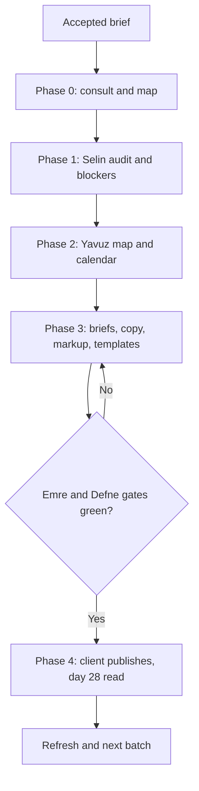

# Workflow: Agency SEO and Content Engine

## Overview & Purpose
Chris coordinates Selin, Yavuz, Kaan, Deniz, Emre and Defne: remove crawl blockers, map intent to pages, publish within capacity, measure and refresh. Never promise rankings.

## Execution Triggers
Load for organic traffic, a content programme, programmatic pages or post-migration recovery. Skip one-page fixes (ask Selin) and paid acquisition. Templated pages at scale bring `programmatic-seo` into Selin's slice.

## Input/Output Requirements
Inputs: the accepted brief; the domain and priority pages; Search Console and analytics exports if supplied; named competitors; the team's content capacity in hours; approval rules; the integration state (`firecrawl`, `chrome-devtools-mcp`, `markitdown`).

Output: Selin's scored audit/fixes; Yavuz's keyword map, clusters, 90-day calendar and ten-field briefs; Kaan's rewrites; Deniz's template changes; JSON-LD; Emre's page checks; Defne's claims review. **Evidence**: keyword volumes with source/date and the raw header/tag behind each technical finding.

## Step-by-Step Runbook

1. **Phase 0: consult and map.** Consult Selin read-only; obtain client acceptance of the Delegation map. Report effort and indicators, never ranking promises.
2. **Phase 1: Selin** audits with `seo-audit` and `technical-seo-audit`; critical blockers (noindex, robots, canonical, redirects) are fixed first, because content on a blocked page is wasted. Her fix list is a fixed input to Phase 3.
3. **Phase 2: Yavuz.** Keyword and intent map (one intent per URL), cluster map, a 90-day calendar from `content-calendar-strategy` with hours and dependencies, checked by Selin for cannibalisation.
4. **Phase 3: production.** Yavuz briefs writers; Kaan rewrites titles/descriptions/key copy; Selin writes JSON-LD/metadata snippets; Deniz applies templates. Keyword map and snippets must exist as files before Deniz or Kaan starts.
5. **Gate and hand-off.** Emre checks the changed pages (status, canonical, rendering, links); Defne reviews claims, comparisons and any ratings or reviews markup.
6. **Phase 4: publish and measure.** Client publishes; read indexed/submitted counts, impressions and cannibalisation at day 28; decide refresh and next batch.

| Transition | Prerequisites | Gate (evidence) | Success criteria |
|---|---|---|---|
| Phase 1 -> Phase 2 | Audit delivered with evidence per finding | Lead read the findings and the fix list | Critical blockers have owners and dates |
| Phase 2 -> Phase 3 | Keyword map and calendar exist as files | Selin confirmed no cannibalisation | Every item has an owner, hours and a source for each keyword |
| Phase 3 -> Phase 4 | Briefs, copy, snippets and template changes ready | Emre green and Defne cleared | No unsupported claim; structured data matches the page |
| Phase 4 -> Refresh | First batch live and 28 days read | Counts, not impressions of success | Decisions recorded: keep, refresh, merge, stop |

Rollback protocol: if a template change breaks rendering or indexation, Deniz reverts that change (the redirect map and the previous template stay available), Emre re-runs the checks, and the content batch waits; no new URL is published on a template that failed the gate.

**Optional media.** Chris records Media Requests and include/defer/decline during bounded consultation. If installed and included, load `workflow-agency-motion-production` under this Lead: approved brand/copy/assets, timing approval, production, Sound handoff, applicable render and review. Sound-only needs no Motion/video; static/defer/decline starts no production, install or provider.

## Code & Config Exemplars
Load [examples/worked-example.md](examples/worked-example.md) for the delegation map of an engagement with 25 hours a week of capacity. The playbook works without it.

Anti-patterns, each with its reason:
- Content before the blockers are removed: it cannot be indexed.
- A calendar with no hours behind it: it is a wish.
- Promised rankings or traffic numbers: nobody can know them.
- Templated pages without the publish gate: they are thin pages.
- Success judged by impressions alone: they are not the goal.

## Edge Cases & Error Recovery
- **No Search Console access**: audit from outside, list what could not be checked, ask the client for the export first.
- **A migration in progress**: freeze URL-changing work until the redirect map exists.
- **Capacity drops**: Yavuz lists which items slip first; the lead gives the client the new dates.
- **The client wants fast results**: search takes weeks to months to show effects; propose leading indicators.

## Verification Checklist
- [ ] Selin's critical blockers are fixed or owned before content is scheduled.
- [ ] Every keyword and volume has a source and a date; each URL has one intent.
- [ ] The calendar is at or under 80 percent of capacity, with owners and dependencies.
- [ ] Emre and Defne gates are green, or the open items are listed with owners.
- [ ] The report promises effort and indicators, names the day-28 read-out, and a rollback route exists.
